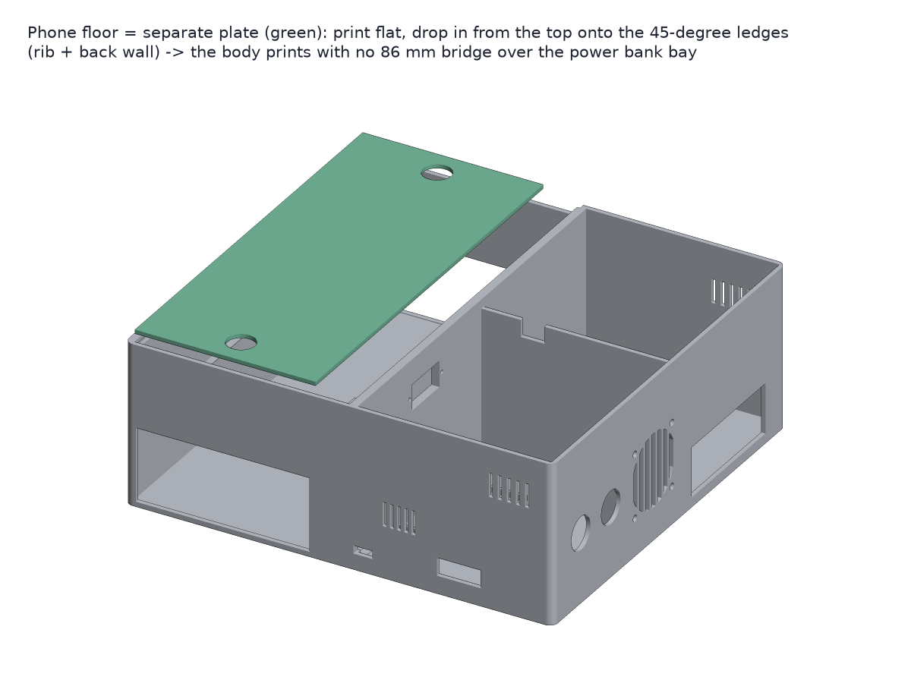
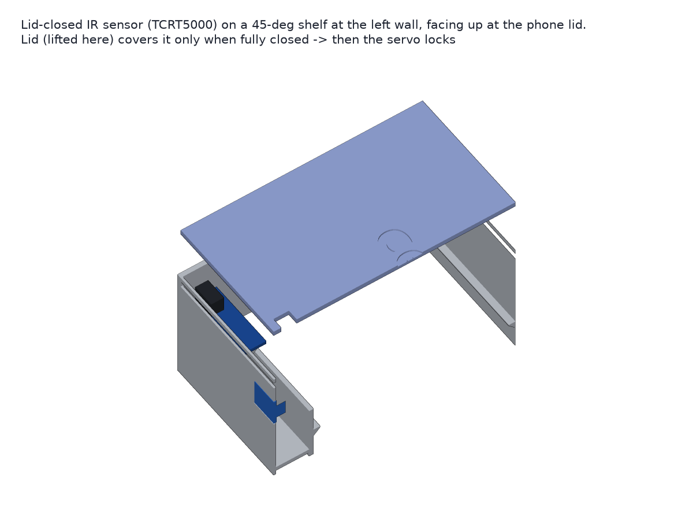
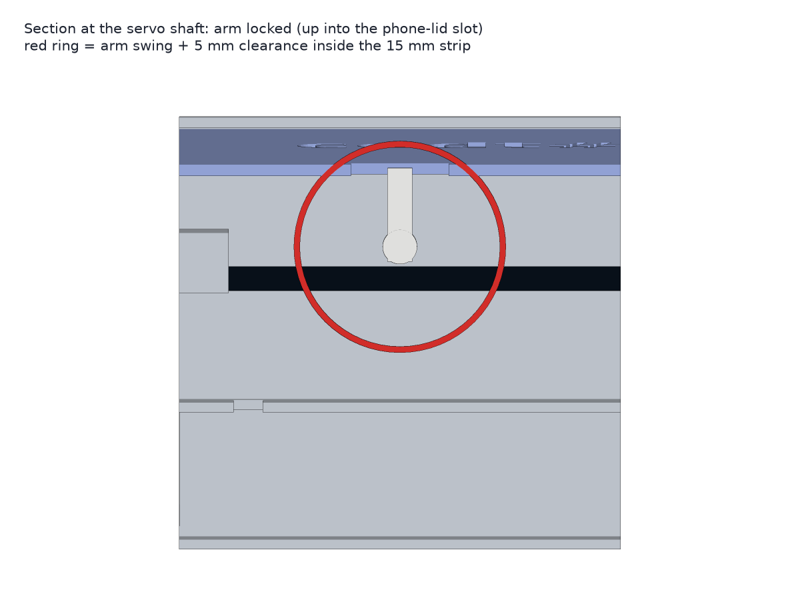
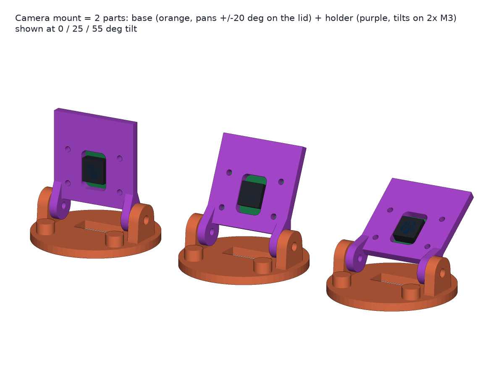
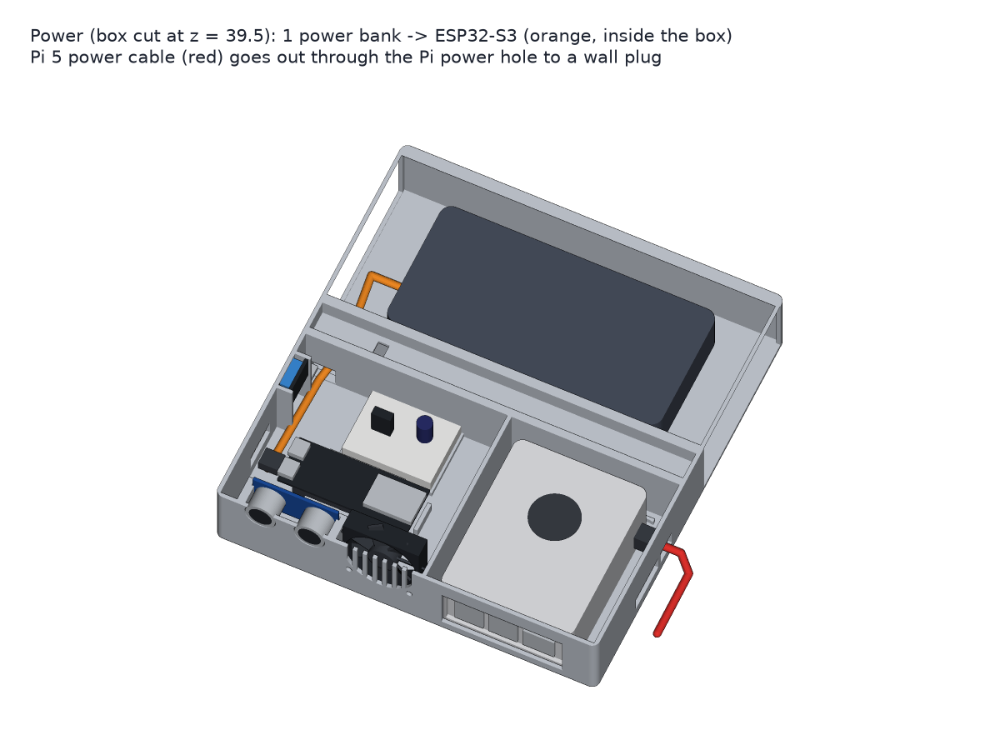
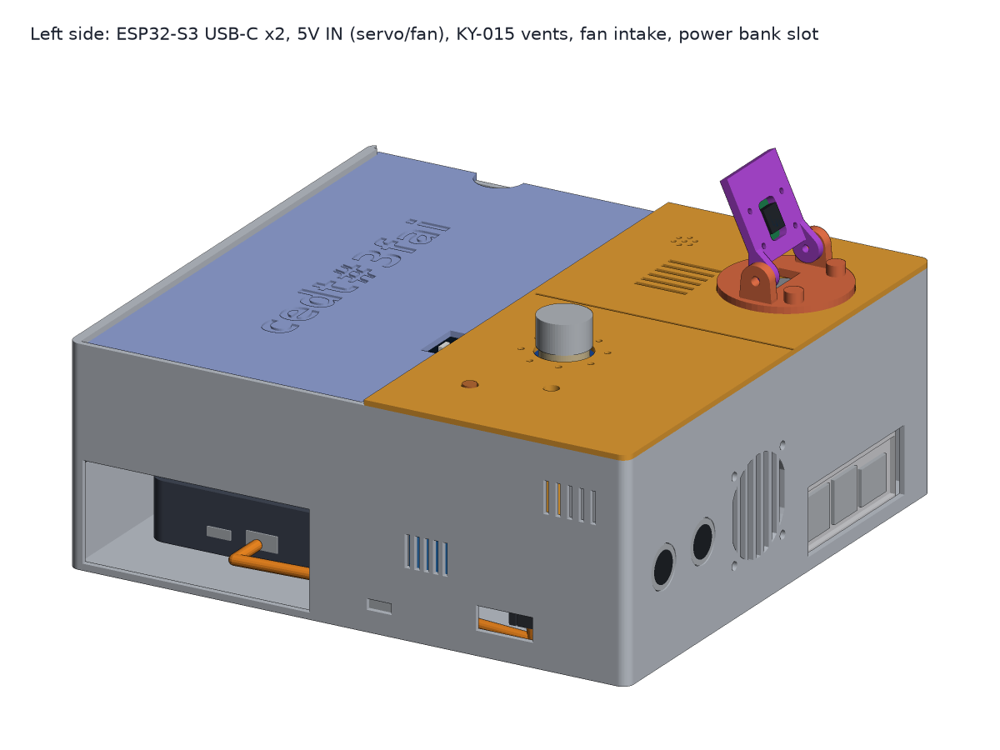
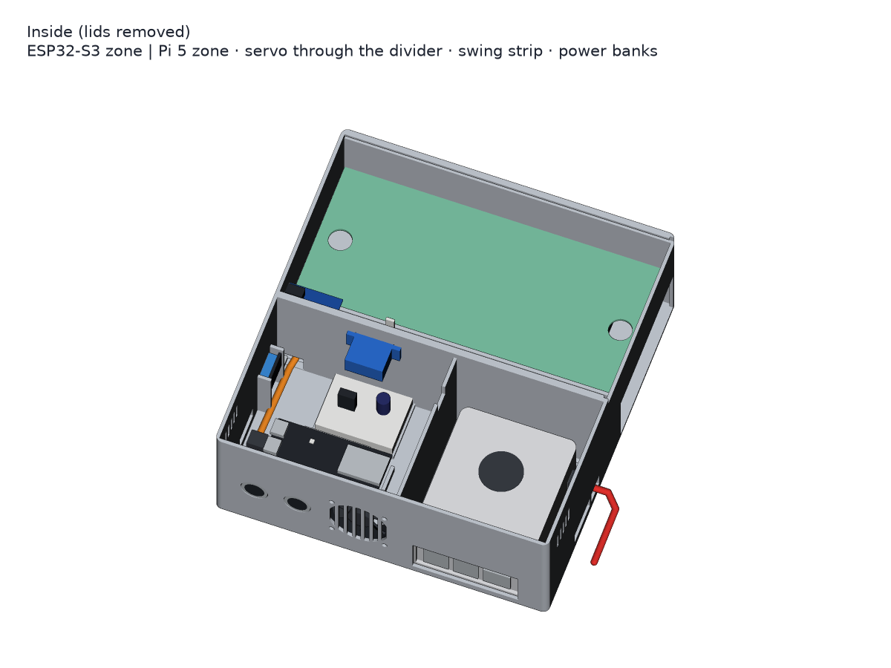

# design — กล่องเดียว (merged) สำหรับ Smart Study Desk

กล่องหลัก ช่องมือถือ และช่อง power bank **รวมเป็นตัวกล่องชิ้นเดียว** ขนาด **202 × 214.5 × 83 มม.** (รวมฝา) — ขยายจากเดิม 1 ซม. ทุกด้าน (กว้าง/ลึก/สูง)


```
 ด้านหลัง  ┌──────────────────────────────────────────────┐
           │ ช่องมือถือ (ฝาเลื่อน → ออกขวา)        z 42–66 │
           │ Power bank 1 ช่อง (เปิดซ้าย/ขวา)      z  2–40 │
           │ ── ผนังกันมือถือ ─────────────────────────── │
           │ ช่องสวิง servo 15 มม.                          │
           │════════ ผนังกั้น (servo ยึดตรงนี้ แกนลอดผ่าน) ═│
           │  โซน ESP32-S3 (Sensor Node)  │ โซน Pi 5       │
 ด้านหน้า  └──────────────────────────────────────────────┘ (หันหาผู้ใช้)
```

**ดูแบบ 3D:** รัน `python -m http.server` ในโฟลเดอร์นี้ แล้วเปิด `http://localhost:8000/viewer.html`
- **เอาเมาส์ชี้ที่ชิ้นไหนก็ได้** จะขึ้นชื่อ หน้าที่ ขาที่ต่อ และโซน (ชี้ที่ตัวกล่องก็บอกได้ว่าเป็นโซนไหน: ESP32 / Pi / ช่องสวิง / power bank / มือถือ)
- **แบ่งชั้น (Layers):** ติ๊กเปิด/ปิดทีละชั้น ได้แก่ ฝาบน, ฝามือถือ, ตัวกล่อง, อุปกรณ์โซน ESP32, อุปกรณ์โซน Pi, power bank + สายไฟ และมือถือ
  - ปุ่มลัด: **ทั้งหมด / ชั้นบน: ฝา / ชั้นอุปกรณ์ / ชั้นล่าง: power bank**
  - สไลเดอร์ **ตัดดูตามความสูง** และ **ตัดดูจากด้านหน้า** ใช้มองเข้าไปข้างในทีละชั้น
- สไลเดอร์ยกฝา, เลื่อนฝามือถือออก, ปุ่มสลับ servo ล็อก/ปลดล็อก, โหมดกล่องโปร่งใส

## ไฟล์พิมพ์ (STL)

| ไฟล์ | ขนาด (มม.) | หมายเหตุ |
|---|---|---|
| `stl/smart_desk_box_body.stl` | 202 × 214.5 × 81 | ตัวกล่องทั้งหมด (ชิ้นเดียว) |
| `stl/smart_desk_box_lid.stl` | 202 × 101 × 67 | ฝาส่วนอิเล็กทรอนิกส์ (วางในแนวพิมพ์แล้ว สูงเพราะมีท่อนำแสง LED) |
| `stl/phone_lid.stl` | 200 × 110 × 2.3 | ฝาเลื่อนช่องมือถือ · สลักตัวอักษร **cedt#3fai** ลึก 0.8 มม. บนผิวบน |
| `stl/camera_base.stl` | Ø46 × 15.5 | ฐานกล้อง (ชิ้น 1) หมุนซ้าย/ขวาได้ ±20° |
| `stl/camera_holder.stl` | 40 × 10 × 32 | ที่จับกล้อง (ชิ้น 2) ปรับก้ม/เงยได้ · วางในแนวพิมพ์แล้ว (นอนตะแคง) |
| `stl/phone_floor.stl` | 197.4 × 90.4 × 2 | **พื้นช่องมือถือ (ชิ้นแยก)** พิมพ์แบนบนฐาน แล้ววางลงจากด้านบน |

**ต้องใช้ฐานพิมพ์ ≥ 220 × 220 มม.** (ตัวกล่อง 202 × 214.5) ใช้เส้นประมาณ 400 g
**พื้นช่องมือถือแยกเป็นชิ้น `phone_floor.stl` แล้ว** ตัวกล่องจึงไม่มีเพดานกว้าง 91 มม. ลอยเหนือช่อง power bank อีก
- ผนังกันมือถือและผนังหลังมี **บ่ารับเอียง 45° (ลึก 3 มม.)** ที่ z = 40 พิมพ์ได้โดยไม่ต้องใช้ support
- ประกอบ: วางแผ่นพื้นลงจากด้านบนของช่องมือถือ ให้วางบนบ่าทั้งสองฝั่ง (เผื่อระยะ 0.3 มม.) จะหยอดกาวร้อนที่มุมก็ได้ หรือไม่ติดกาวก็ได้ ยกออกได้ทางรูนิ้ว 2 รู
- ที่ยังเป็น bridge มีแค่ขอบบนของช่องเปิด power bank ในผนังซ้าย/ขวา (กว้าง 87 มม. หนา 2 มม.) ถ้าเครื่องพิมพ์ bridge ช่วงนี้ไม่สวย ให้เปิด support แบบ "touching buildplate" ซึ่งจะสร้าง support แค่ใต้ขอบสองช่องนี้ และดึงออกจากด้านนอกได้ง่าย



## โซน ESP32-S3 (Sensor Node)

| อุปกรณ์ | ตำแหน่ง | ขา |
|---|---|---|
| ESP32-S3 DevKitC | รางบนพื้น ห่างผนังซ้าย 15 มม. (ที่ว่างให้หัวปลั๊ก USB-C จากสายด้านใน) + ช่อง USB-C ที่ผนังซ้ายสำหรับเสียบจากด้านนอก | — |
| RGB LED บนบอร์ด | **ท่อนำแสง**จากฝาลงไปเหนือ LED → เห็นสีสถานะจากด้านบน (ตำแหน่ง LED แต่ละบอร์ดไม่เท่ากัน ให้ปรับค่า `ESP_LED`) | GPIO48/38 |
| HY-SRF05 | หน้ากล่อง เสียบลงร่องราง | TRIG GPIO7, ECHO GPIO15 (ตัวแบ่ง 1k/2k) |
| พัดลม 5V 40 มม. | หลังตะแกรงหน้ากล่อง ดูดลมจากช่องผนังซ้าย | GPIO10 → MOSFET |
| KY-015 (DHT11) | ผนังซ้าย หันเข้าช่องระบาย | GPIO6 |
| KY-018 (LDR) | ใต้ฝา ตัว LDR โผล่ผ่านรู Ø6 | GPIO5 |
| MQ135 | ใต้ฝา ตัวเซนเซอร์โผล่นอกฝา | GPIO4 |
| Mini breadboard | ราง 5V + MOSFET IRLZ44N + 1N4007 + C 470µF + ตัวแบ่งแรงดัน | — |
| **ช่องรับไฟ 5V (USB-C breakout)** | **ผนังซ้าย** จ่ายไฟให้ servo + พัดลม แยกจาก ESP32 | — |
| **IR TCRT5000 (ฝามือถือปิดสนิท)** | ชั้นวางเอียง 45° ในช่องสวิงชิดผนังซ้าย หันขึ้นใต้ฝามือถือ (ห่าง 3 มม.) · สายลงรูพื้นช่องสวิง → ช่องร้อยสาย → โซน ESP32 | DO → GPIO16 |
| **Servo SG90** | **ยึดสกรู M2 กับผนังกั้นฝั่ง ESP32 · แกนลอดผนังเข้าช่องสวิง** | GPIO9 |

## Servo ล็อกฝามือถือ

**ลำดับการล็อก (เปลี่ยนใหม่):** ไม่ใช้ IR ตรวจว่ามีมือถือแล้ว แต่ใช้ IR **ตรวจว่าฝาเลื่อนปิดสนิทแล้วค่อยล็อก**
- เซนเซอร์ TCRT5000 อยู่ที่ปลายซ้ายสุดของช่องสวิง หันขึ้นใต้ฝา ฝาจะบังเซนเซอร์ก็ต่อเมื่อเลื่อนเข้ามาจนเหลือไม่ถึงประมาณ 3 มม. จากตำแหน่งปิด
- ตอนนั้นร่องล็อกบนฝาจะตรงกับแขน servo พอดี → ESP32 อ่าน GPIO16 = เจอฝา แล้วค่อยสั่ง servo ตั้งแขนขึ้น
- ถ้าฝายังเปิดอยู่ servo จะไม่ล็อก ไม่มีปัญหาแขนชนฝาหรือล็อกทั้งที่ยังไม่ปิด (ปรับความไวที่ตัวต้านทานปรับค่าบนโมดูล)



- **แขนตั้ง = ล็อก:** ปลายแขนเข้าร่องฝามือถือ 1.5 มม. ทำให้ฝาเลื่อนไม่ได้
- **แขนนอน = ปลดล็อก**
- ช่องสวิงกว้าง **15 มม.** ระยะห่างรอบแขน (ตรวจจากโมเดล):

| ระยะ | มม. |
|---|---|
| แขน → ผนังกั้นด้านหน้า | 5.1 |
| แขน → ผนังกันมือถือ | 8.3 |
| ปลายแขน (ชี้ลง) → พื้นช่องสวิง | 5.8 |
| ปลายแขน (ชี้ข้าง) → ผนังข้าง | 43.9 |

หมุนครบรอบได้โดยไม่ชนอะไร (วงแดงในภาพคือวงสวิง + ระยะเผื่อ 5 มม.)



## โซน Raspberry Pi 5 (Gateway)

| อุปกรณ์ | ตำแหน่ง |
|---|---|
| **Raspberry Pi 5 ในกล่อง 9 × 7 ซม.** | วางในขอบล็อกบนพื้น (ความสูงกล่อง Pi สมมติไว้ 32 มม.) · USB/LAN ออกด้านหน้า · **ไฟ Pi: สายจากกล่อง Pi ลอดรูไฟ Pi ที่ผนังขวา ออกไปเสียบปลั๊กข้างนอก** (ไม่ใช้ power bank) · มีช่อง micro-HDMI ที่ผนังขวาด้วย |
| Pi Camera (CSI 22-pin) | ฐานกล้อง 2 ชิ้นบนฝาด้านหน้า (ดูด้านล่าง) · สายแพลงรูกลางฐาน → รูกลมบนฝา |
| KY-006 buzzer | ใต้ฝา มีรูกระจายเสียง (GPIO18) |

## ฐานกล้องแบบปรับได้ (2 ชิ้น)



1. **`camera_base`** (ชิ้น 1): ฐานกลมวางในร่องกลมบนฝา ยึด **M3 ×2 จากใต้ฝา** ผ่านร่องโค้ง → **คลายสกรูแล้วหมุนซ้าย/ขวาได้ ±20°**
2. **`camera_holder`** (ชิ้น 2): แผ่นยึดกล้อง (M2 ×4) มีหูบานพับ 2 ข้าง ประกบกับหูของฐาน ร้อย **M3×10 ×2** จากด้านนอกเข้าหูของ holder (เกลียวกินพลาสติก) → **คลายแล้วปรับก้ม/เงยได้ประมาณ -10° ถึง 60°** ขันแน่นเพื่อล็อกมุม (ใส่แหวนรองช่วยให้ฝืดขึ้น)
- สายแพลงช่องตรงกลางฐาน หลังบานพับ แล้วลงรูกลม Ø27 บนฝา (เผื่อหมุน)
- ตรวจจากโมเดลแล้ว: ที่มุม -10° ถึง 60° holder ไม่ชนฐานและไม่ชนฝา

## Power bank (1 ช่อง) — สำหรับ ESP32 เท่านั้น

- ช่องเดียวใต้ช่องมือถือ **สูง 37 มม.** (ความสูงเท่าเดิม แต่ไม่มีชั้นกลางแล้ว) กว้าง 87 มม. ยาวตลอดความกว้างกล่อง รองรับ power bank ประมาณ 150 × 84 × 35 มม. (ก้อนหนาหรือ 20000 mAh ก็ใส่ได้)
- **เปิดได้ทั้งซ้ายและขวา** สอดเข้าออกได้
- **มีช่องร้อยสายภายใน:** ช่อง power bank → รูในผนังกันมือถือ (ซ้ายหรือขวา) → ช่องร้อยสายใต้ช่องสวิง servo → รูในผนังกั้น → โซน ESP32 → USB-C ของ ESP32-S3
- ช่องที่ 2 ของ power bank ใช้ต่อไปราง 5V ของ servo/พัดลมได้ (ร้อยทางเดียวกัน)
- **Pi ไม่ใช้ power bank:** สายไฟของกล่อง Pi ลอดรูไฟ Pi ที่ผนังขวาออกไปเสียบปลั๊กข้างนอก








## ปรับขนาด / สร้างใหม่
ทุกค่าอยู่ด้านบน [build.py](build.py) เช่น `SWING` (ความกว้างช่องสวิง), `ARM` (ความยาวแขน servo), `Z_PHONE_FLOOR` (ความสูงช่อง power bank), `PHONE_DEPTH`, `ESP_LED` — **วัดของจริงก่อนพิมพ์** สคริปต์จะพิมพ์ค่าระยะเผื่อของ servo ออกมาทุกครั้งที่รัน

```powershell
pip install manifold3d trimesh numpy matplotlib
```
```powershell
python build.py
```
